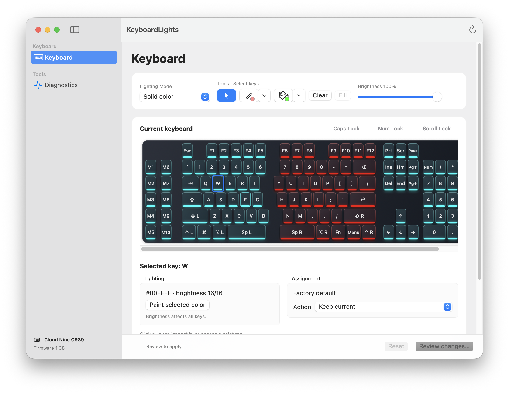

# KeyboardLights

Change the lighting and remap keys on a Cloud Nine C989 keyboard from macOS or
Linux. Preview your changes before applying them, and save profiles to reuse later.

Supports the **legacy C989 with firmware 1.38**. Revised hardware with firmware
1.82 is incompatible.



*KeyboardLights on macOS.*

## Install

Download the installer for your system from [GitHub Releases](https://github.com/pgoodcodeos/kblights/releases):

- **macOS 14 or later, Apple Silicon or Intel:** open the DMG, drag KeyboardLights
  into Applications, and launch it there. Follow the app's Input Monitoring setup
  to allow keyboard access. If macOS blocks the app from opening, follow the
  [first-launch instructions](RELEASE.md#macos).
- **Debian/Ubuntu Linux with Python 3.11+ and GTK 4.12+:** install the `.deb` for
  your architecture, then reconnect the keyboard and launch KeyboardLights.
  Ubuntu 24.04 meets these requirements.

The [installation guide](RELEASE.md#installation) covers package selection,
checksums, permissions, and updates.

The Mac app currently uses ad-hoc signing and is not notarized by Apple. Installer
filenames end in `-adhoc.dmg`; the installation guide explains first-launch approval.

## Use the app

Connect your keyboard. Its current settings load once the app has access to it.
If you see **Keyboard not connected**, check the connection and choose **Refresh**.

1. **Choose your lighting.** Select **Solid color** to paint keys with the brush
   or bucket, or choose an animation and adjust its speed. The pointer selects
   keys without painting them.
2. **Change key assignments.** Select a key and choose its action below the
   keyboard preview.
3. **Review and apply.** Choose **Review changes**, check the summary, tick the
   confirmation box, then choose **Apply changes**.

Edits stay in the preview until you apply them. **Clear** starts a blank lighting
preview; paint or fill every blank key before saving or applying it. Use **Off**
when you want a key's light turned off.

Use **File → Lighting Profile** or **File → Assignment Profile** to save and open
setups. Opening a profile loads it into the preview for review.

**Refresh** reloads the keyboard's settings while keeping your edits. If an update
fails, the app stops and tells you which changes completed.

See the [macOS guide](docs/macos.md) or [Linux guide](docs/linux.md) for paint tools,
profiles, shortcuts, and troubleshooting.

## Build from source

Get the source first:

```sh
git clone https://github.com/pgoodcodeos/kblights.git
cd kblights
```

On macOS, install Xcode with Swift 6 and Python 3.11 or later, then run:

```sh
sh scripts/build-macos.sh
sh scripts/run-macos.sh
```

The build creates `.build/macos/KeyboardLights.app`. It needs the same keyboard
access permission as an installed copy.

On Linux, follow the [dependency and keyboard-access setup](docs/linux.md#build-from-source),
then build and launch:

```sh
sh scripts/build-linux.sh
sh scripts/run-linux.sh
```

The run scripts do not rebuild. Rebuild after changing Swift or C code; Python
changes take effect on the next launch. See [Contributing](CONTRIBUTING.md) for
tests and development guidance.

## Help and feedback

Check the [macOS](docs/macos.md#refresh-and-troubleshooting) or
[Linux](docs/linux.md#files-and-troubleshooting) troubleshooting guide first.
If you're still stuck, [report a bug](https://github.com/pgoodcodeos/kblights/issues/new?template=bug_report.md).
Suggestions are welcome in [GitHub issues](https://github.com/pgoodcodeos/kblights/issues).

Diagnostic logging is off by default. The platform guides explain how to enable
it and where to find logs. Review logs for personal information before sharing them.
For security issues, use the [private reporting instructions](SECURITY.md).

## License

Copyright © 2026 oscoder47. Licensed under the [Apache License, Version 2.0](LICENSE).

The Linux AppStream metainfo file is separately licensed under MIT, as stated in that file.
