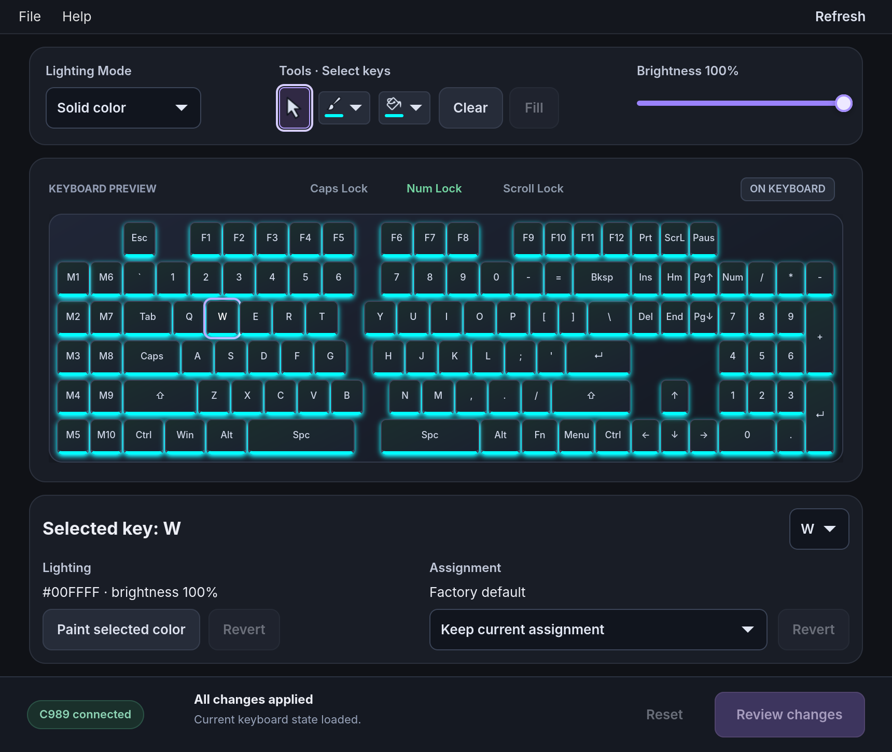

# KeyboardLights on Linux

KeyboardLights supports the **legacy Cloud Nine C989 with firmware 1.38**.
Revised keyboards with firmware 1.82 are incompatible.

## Start here

[Install the Debian/Ubuntu package](../RELEASE.md#linux), reconnect the keyboard,
and open **KeyboardLights** from your application menu. You can also run
`keyboardlights` in a terminal. Run it as your normal desktop user.

Wait for **C989 connected** and **Current keyboard state loaded** in the footer.
The preview then shows the keyboard's current lighting and key assignments.
If it stays disconnected, connect the keyboard and choose **Refresh** at the
top right.



Lighting controls sit above the keyboard. Select a key to see its lighting and
assignment side by side below it. Edits stay in the preview until you review
and apply them.

## Change lighting

Choose **Solid color** in **Lighting Mode** to paint keys and adjust brightness.
The pointer starts selected; clicking a key only shows its details.

| Tool | What it does |
|---|---|
| Pointer | Select a key without painting it. |
| Paint brush | Paint the key you click. |
| Paint bucket | Fill connected keys that match the clicked key's color. |

Open the brush or bucket palette and choose a preset, **Last**, or **Custom…**
for an exact RGB color. Then click the keys to paint. Each tool keeps its own
color and remembers its last-used non-Off color between launches. Cancelling
Custom keeps the previous color.

The bucket stops at different colors and gaps between keyboard sections.
Blank keys form their own regions. **Off** explicitly turns a key's light off;
it is different from leaving a key blank.

**Clear** makes the preview blank. **Fill** colors only blank keys, keeping
existing colors and Off keys. It uses the bucket's color when the bucket is
selected, otherwise the brush's color. To give the whole keyboard one color,
choose a brush color, then **Clear → Fill**. Paint or fill every blank key before
saving a lighting profile or reviewing changes.

Choose **Reset** to discard all lighting edits, or use **Revert** under the
selected key's lighting to undo just that key's color change. Brightness applies
to the whole keyboard.

Choose one of the nine animations in **Lighting Mode** and adjust **Speed**.
Painting controls are hidden. A newly selected animation uses its full-color
palette at full brightness; the preview shows a static sample of its colors.
Returning to Solid color keeps your static draft and brightness and selects
the pointer again. Profiles retain their saved animation settings.

## Change a key assignment

1. Choose the pointer, then click a key in the preview. You can also use the
   **Selected key** dropdown below it.
2. Under **Assignment**, choose an action: **Factory default**,
   **Keyboard key / shortcut**, **Mouse**, **Media**, or **Disable key**.
3. Choose the output and any shortcut modifiers shown for that action.

Changes are staged immediately. Choose **Keep current assignment** or click the
assignment's **Revert** button to remove that key's staged assignment. These
controls leave its lighting alone. To restore the keyboard's original mapping, choose
**Factory default** and apply the change.

Shortcuts send key presses, so the characters depend on your active keyboard
layout. Media and application actions depend on your desktop environment.

## Apply your changes

Choose **Review changes** in the footer. Check the lighting and assignment
summary, tick **Apply all reviewed changes to my keyboard**, then choose
**Apply changes**. **Keep editing** closes the review without applying anything.

Assignments and lighting are applied in separate verified steps. If one fails,
the app stops and tells you what completed; it does not automatically retry or
roll back. **Refresh** reads the keyboard again while keeping your staged edits.

## Save and open profiles

Use **File → Lighting Profile** for lighting or **File → Assignment Profile**
for assignments. Each menu has the same file actions:

| Action | What happens |
|---|---|
| New | Start a fresh draft. New lighting drafts start blank. |
| Open | Load a profile into the preview. |
| Save | Update the current file, or ask for a filename on the first save. |
| Save As… | Save to another file and use it as the current profile. |
| Delete current | Confirm deletion of the file; keep the draft open to save again. |

Saving or opening a profile does not apply it to the keyboard. If a profile
changes on disk while it is open, Save keeps your draft and asks you to open
the file again. Use **Save As…** to keep your draft in a different file.
You can still save a loaded draft after the keyboard disconnects.

**Ctrl+S** saves and **Ctrl+O** opens a profile of the type you most recently
selected in the File menu; both default to Lighting Profile. **Ctrl+R** refreshes,
**Ctrl+Enter** opens the review, and **Ctrl+Q** quits.

## Files and troubleshooting

Profile dialogs start in `~/.config/KeyboardLights/Profiles`. Preferences and
optional diagnostic logs use `~/.local/state/KeyboardLights`. If you set
`XDG_CONFIG_HOME` or `XDG_STATE_HOME`, the app uses those locations instead.
Removing or purging the package keeps these files.

| Problem | What to try |
|---|---|
| Keyboard not connected | Connect the legacy C989 and choose **Refresh**. |
| Keyboard access denied | Unplug and reconnect after installation, then choose **Refresh**. For a source build, install the access rule below. |
| Review changes is disabled | Check that the keyboard is connected, you have changed a setting, and no keys are blank. |
| Key assignments did not load | Choose **Refresh** and check the error message in the footer. |

For troubleshooting logs, close the app and relaunch it with:

```sh
keyboardlights --diagnostic-logging
```

For a source build, use `sh scripts/run-linux.sh --diagnostic-logging`.
Logs are off by default; relaunching without the flag turns them off again and
keeps earlier logs. Check logs for personal paths and profile content before
sharing them. **Help → About** shows the version and license;
`man keyboardlights` lists command-line options for the installed package.

## Build from source

You need Python 3.11+, a C compiler, GTK 4.12+, PyGObject, and pycairo.
On Ubuntu 24.04 or a compatible system, install the dependencies:

```sh
sudo apt install build-essential python3 python3-gi python3-gi-cairo gir1.2-gtk-4.0
```

An installed KeyboardLights package already sets up keyboard access. Otherwise,
run these commands once from the checkout root:

```sh
sudo install -m 0644 packaging/linux/70-keyboardlights.rules /etc/udev/rules.d/70-keyboardlights.rules
sudo udevadm control --reload-rules
```

Unplug and reconnect the keyboard so the rule takes effect. It gives the active
local desktop user access to the supported keyboard.

From the checkout root, build and launch as your normal desktop user:

```sh
sh scripts/build-linux.sh
sh scripts/run-linux.sh
```

The run script does not rebuild. Rebuild after changing C code; Python, CSS,
and SVG changes take effect on the next launch. For offline tests, see
[Contributing](../CONTRIBUTING.md#tests). To build a `.deb`, see
[Linux packages](../RELEASE.md#linux-packages).
