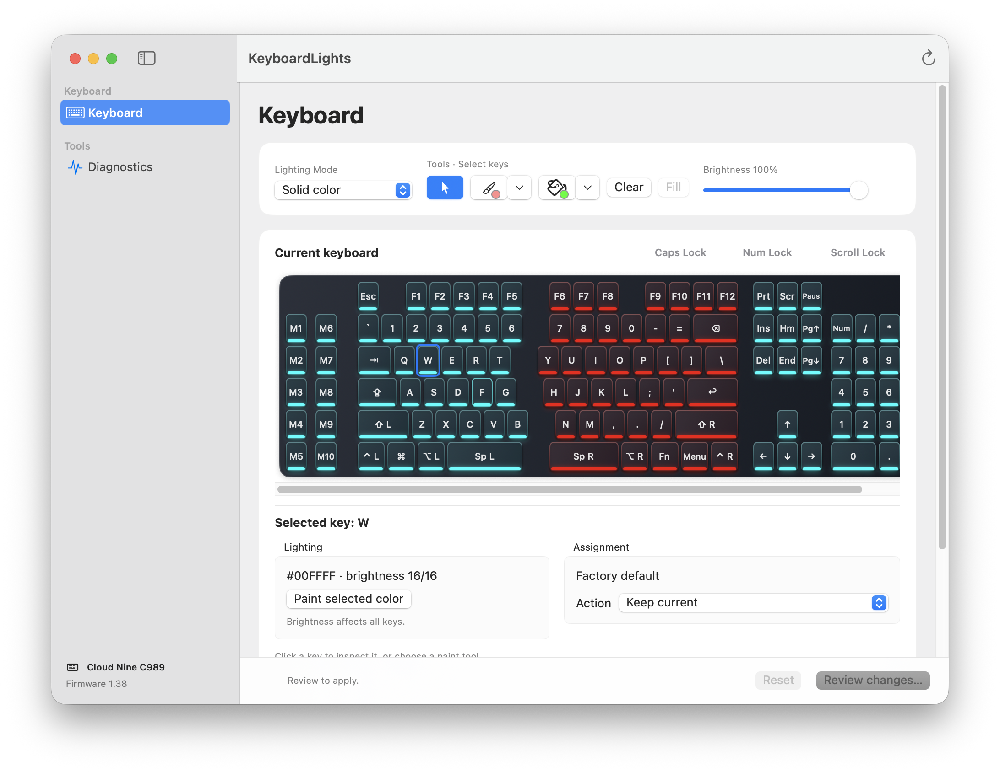

# macOS guide

KeyboardLights supports macOS 14 or later and the legacy Cloud Nine C989 with
firmware 1.38. The universal installer works on Apple Silicon and Intel Macs.
Revised C989 hardware with firmware 1.82 is incompatible.

Follow the [installation and keyboard-access steps](../RELEASE.md#macos) first.
Once your keyboard is connected and Input Monitoring is approved, its settings
load automatically.



## Edit lighting

The keyboard preview shows your draft. Editing it does not change the physical
keyboard until you review and apply the changes.

1. Choose **Solid color** or an animation from **Lighting Mode**.
2. For static colors, choose the brush or bucket. Click the arrow beside a tool
   to open its palette, then choose a preset, **Last**, or **Custom…** color.
3. Click keys in the preview. The brush paints one key; the bucket fills connected
   keys of the same color. It does not cross the gap between the keyboard halves.
4. Choose **Review changes…**, check the changes, tick the confirmation box, then
   choose **Apply changes**. Keep the keyboard connected until the update finishes.

Choose the pointer to inspect keys without painting. Each key's details appear
below the preview. The selection outline is separate from its lighting color.

In the custom-color chooser, choose **Use color** to confirm. **Cancel** keeps
your current tool and color.

Each paint tool remembers its own last-used non-Off color between launches.
**Off** turns a key's light off; it is different from a blank, unpainted key.

- **Clear** makes every key blank in the draft.
- **Fill** colors only blank keys. Choose a paint color first; Fill keeps painted
  colors and explicit Off choices.
- **Reset** discards lighting edits and restores the last verified settings.
- A key's lighting **Revert** restores that key without discarding other edits.

Finish painting or filling blank keys before saving or applying static lighting.
**Brightness** affects the whole keyboard. Animations show **Speed** instead;
the preview shows colors, while the animation plays on the physical keyboard.
Choosing a new animation starts it in full color at full brightness. Switching
back to **Solid color** restores your static draft, including unfinished blanks.
Profiles keep their saved animation settings.

## Change a key assignment

Choose the pointer, then click a key. In **Assignment** below the keyboard,
choose an action and, where needed, an output key or modifiers. You can assign
keyboard keys or shortcuts, mouse actions, media actions, or disable a key.
Shortcuts send keypresses rather than text; your active keyboard layout determines
the characters.

**Keep current** leaves the key's existing assignment alone. **Factory default**
restores its original function. Assignment **Revert** removes that key's planned
change. These controls do not change its lighting.

**Planned changes** lists your assignment edits. Its options menu can clear the
assignment draft or save an offline plan. An offline plan describes the edits;
it is separate from a reusable profile.

Lighting and assignment edits appear in the same **Review changes…** window.
The app applies them in separate steps and verifies each result. If a step fails,
it stops and reports what finished. It does not retry or undo a completed step
automatically.

## Save and open profiles

Use **File → Lighting Profile** for lighting and **File → Assignment Profile**
for key assignments. Saving a profile saves a JSON file; applying changes saves
them to the keyboard.

| Action | What it does |
|---|---|
| **New** | Starts a blank lighting draft or an empty assignment draft. |
| **Open…** | Loads a file into the draft for review. |
| **Save** | Updates the current file, or asks for a filename on the first save. |
| **Save As…** | Saves a separate copy and makes it the current file. |
| **Delete Current…** | Asks before moving the current file to Trash. The draft stays open. |

New and Open ask before discarding unsaved edits. If a file changes outside the
app, Save refuses to overwrite it. Open it again to use the changed file, or use
Save As to keep your draft in a separate file. Save As also works when the
original file is missing or damaged.

Files can contain lighting, assignments, or both. For a combined file, open it
from each profile menu to load both sections. Saving one section keeps the
other section's saved settings. Deleting a combined file moves the whole file
to Trash; the confirmation tells you when it contains both sections.

**⌘O**, **⌘S**, and **⇧⌘S** open, save, or save a copy for the last profile type
you used. The File menu's shortcut labels show whether they act on lighting or
assignments. Lighting is the default when you open a new app window.

Profile actions require a connected keyboard with access approved. Lighting
also needs a successful read, and static lighting must have no blank keys.
Actions pause during keyboard operations and confirmation dialogs.

## Refresh and troubleshooting

**Refresh** checks the connection and reloads keyboard settings while keeping
your edits. It does not apply the draft.

- **Keyboard not connected:** connect the supported C989, then choose Refresh.
- **Allow keyboard access:** follow the [Input Monitoring setup](../RELEASE.md#keyboard-access-on-first-launch).
  Use **Show app in Finder** if you need to add the running app to System Settings.
- **Settings could not be read:** choose Refresh to try again. Assignment profile
  actions remain available after a lighting read fails.
- **An update needs inspection:** read the error and save any drafts you want to
  keep. Further writes are blocked. Report the problem rather than repeatedly
  trying to apply the same changes.

For troubleshooting logs, open **Diagnostics** and enable **Save diagnostic logs**
before repeating the problem. Logging is off by default and applies to subsequent
operations. **Show records in Finder** opens the data folder. Turning logging off
keeps existing logs. Check files for personal paths, device identifiers, and
profile content before sharing them in a [problem report](../CONTRIBUTING.md#report-a-problem).

## Your files

New profile files default to:

```text
~/Library/Application Support/KeyboardLights/Profiles
```

You can choose another folder in the file dialog. Diagnostic records, when
enabled, are under `~/Library/Application Support/KeyboardLights`.
Updating or removing the app keeps these files. Older profile libraries migrate
to individual files on first use, with the original library kept for recovery.

For source builds, see the [README](../README.md#build-from-source).
